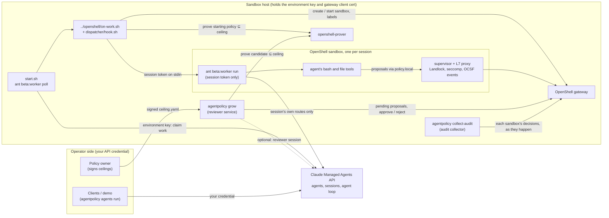
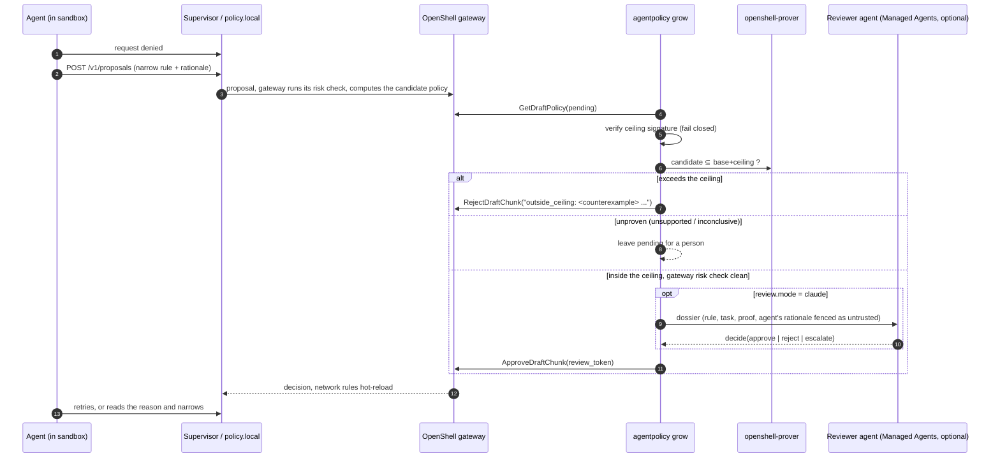

# Architecture

This document explains how the pieces fit, what each one is trusted with, and what
the design proves, assumes, and leaves open.

## Goal

Run Claude Managed Agents sessions with each session's tools in an OpenShell
sandbox, so that:

1. a person decides the **most** access each kind of agent may ever have (its ceiling);
2. no sandbox runs a policy that is not **proved** inside that ceiling by OpenShell's prover;
3. inside the ceiling, a kind of agent starts with what its sessions were seen to **use**,
   worked out in staging and merged by a person;
4. every step is **recorded**.

It does not try to decide what an agent should be allowed to do in the first place.
That is the ceiling, and it stays a human decision.

## Two phases

**Discover** answers "what does this agent need?". Proposals are on, in staging. `grow`
decides each one, and `promote` and `shrink` turn what sessions used into a diff of the
profile's `policy.yaml` that a person reads and merges. **Run** answers "is it held to what
we agreed?". Proposals are off, `policy.yaml` changes only by a reviewed commit that CI
proves, and the dispatcher proves every sandbox. Between them a person freezes the policy
and narrows the ceiling to fit.

The parts divide the same way. The core serves both phases: the signed ceiling, the prover
client, `prepare`, `verify-sandbox`, `check`, the hook, the ledger, the collector and the
kill switch. `grow`, `promote`, `shrink`, the breaker and the Claude reviewer serve
Discover.

## Threat model

**What is protected:** where a session's tools can send and fetch data over the network.

**Who is trusted.** The policy owner, with what each kind of agent may ever reach. The
operator and the agentpolicy account, with everything on the sandbox host short of widening a
ceiling. OpenShell, to enforce the policy it is given and to log what it decided. The Managed
Agents API, to report a session's agent truthfully.

**Who is not.** The agent, everything it reads, and every process in its sandbox. Whoever can
create sessions, beyond choosing among the environments and agents the operator listed.

| The agent | What holds it | What does not |
|---|---|---|
| Makes a mistake, or wanders | Its starting policy, which is close to what the task uses. The ceiling. | |
| Follows injected instructions, with proposals off (Run) | Its starting policy. It cannot widen it. | |
| Follows injected instructions, with proposals on (Discover) | The ceiling, and nothing tighter: it can ask for each ceiling rule and be given it. A person reads the diff before any of it reaches other sessions. | Grow, as a control. The "used it" test in promote: the agent decides what it uses. |
| Sends data out through a host it is allowed | Nothing here. | Any proof. See "Writing a ceiling" in the README. |
| Forges evidence of use, to keep or spread a rule | The collector reads the gateway's stream from outside the sandbox and drops lines the sandbox's policy does not explain. Real use of a rule it holds still counts. | |
| Floods the reviewer | Five proposals per sandbox per pass, one proof each, and the breaker for what is rejected. | In `claude` mode each in-ceiling proposal still costs a reviewer session. |
| Fights the kill switch | The network rules go first. A sandbox it has put in Error is deleted. | About eight seconds pass before the empty policy takes effect. |
| Escapes the workload container | Nothing here. That is OpenShell's and Docker's boundary. | |

| Someone else | What holds them | What does not |
|---|---|---|
| A session creator picks a wider profile | Profiles belong to environments, which the operator maps. `profiles.<p>.agents` lists who may run there. | With `agents` empty, any agent sent to that environment runs under its profile. |
| A session creator turns web tools or MCP servers on for one session | `admit` reads the resolved agent and refuses. | A change after the work item was admitted, until the next one. |
| The agentpolicy account is compromised | It cannot widen a ceiling: with `protect_signers` it can neither sign nor replace the signers file. | Everything else. It holds the gateway certificate, so it can approve any rule on any sandbox until that sandbox's next `verify-sandbox`, and it writes the ledger, the environment map and `policy.yaml`. |
| A person with the gateway certificate approves a rule by hand | `verify-sandbox`, at the session's next work item. | Until then the rule is live. |
| An old signed ceiling is put back | Nothing (Open points). | |

## Components



| Component | Runs where | Job |
|---|---|---|
| Claude Managed Agents API | Anthropic | Agents, sessions and the agent loop. Never runs agent code. |
| `start.sh` | Sandbox host | Runs `../openshell`'s poller, which claims sessions from the worker environment with the environment key, with `ON_WORK_HOOK=dispatcher/hook.sh`. |
| `../openshell/on-work.sh` + `dispatcher/hook.sh` | Sandbox host, per session | The quickstart's script owns the sandbox lifecycle and the token handoff. The hook decides: it takes the session's profile from the operator's environment map and its agent's id and version from the session (read with the session's own token), refuses a session a stop covers, refuses an agent the profile does not admit, writes a new sandbox's starting policy only once it is proved inside the signed ceiling (`agentpolicy prepare`), and proves the policy the gateway reports for the sandbox (`agentpolicy verify-sandbox`) right after it is made and each time it is reused or restarted. A reused sandbox that no longer fits is replaced. One run per session at a time. |
| OpenShell gateway | Sandbox host | Sandbox lifecycle, policies, the proposal inbox, hot reload of network rules, and a buffered stream of each sandbox's log. |
| Sandbox supervisor | Per sandbox | Enforces the policy outside the agent's process; streams every network decision to the gateway as an OCSF event. |
| `agentpolicy grow` | Sandbox host | The reviewer service: decides each pending proposal. |
| `agentpolicy collect-audit` | Sandbox host | The audit collector: follows every worker sandbox's stream and keeps the allowed decisions that its policy explains, as evidence of use. It keeps the denied ones too, apart, as a record. |
| `openshell-prover` | Sandbox host | Every containment decision. |
| Reviewer agent | Managed Agents session, no worker | Optional judgement step with one custom tool, `decide`. |
| `agentpolicy promote` / `shrink` | Operator, by hand | Print a proved change to a profile's starting grants as a diff. `--apply` writes it. |
| `agentpolicy stop` / `resume` | Operator, on demand | The kill switch (see Stopping). The reviewer's circuit breaker uses the same path. |

## Credentials

| Credential | Held by | Can do | Never reaches |
|---|---|---|---|
| Your API credential (`ant auth login` or `ANTHROPIC_API_KEY`) | `ant apply`, the demo, the reviewer service (in `claude` mode, and so its circuit breaker can interrupt sessions), `agentpolicy stop` and `resume` | Create agents and sessions; run reviewer sessions; interrupt sessions; free refused sessions' work items | The sandbox host's dispatcher, any sandbox |
| Environment key | The poller and the first lines of `on-work.sh` | Claim any session queued to the worker environment | Any sandbox |
| Session (worker) token | One sandbox's worker, over stdin; the hook's `admit` briefly, to read the session's agent | That session's routes, for a short time | Files, arguments, environment variables, the stored sandbox definition |
| Gateway client certificate | The reviewer service, the audit collector, the dispatcher (through the `openshell` CLI). With `stack/openshell`, every sandbox's supervisor container too: `make pki` makes one client certificate, and `gateway.toml` names it as the Docker driver's `guest_tls_cert`. | Approve rules, create sandboxes, read sandbox logs | Any workload container, where the agent runs |
| Gateway CA key, JWT signing key (`state/openshell/pki`) | The gateway | Mint client certificates; forge a sandbox's identity, and so its log stream and proposals | Any sandbox. Nothing needs the CA key after `make pki`: move it off the host. |
| The Docker socket | The gateway, the operator | Everything on the host | Any sandbox |
| Ceiling signing key | The policy owner | Change what a profile may ever hold | Every machine that runs agents |

The agent can read its own session token (its shell runs as the worker's user), and its
shell, a child of the worker, can use the base rule's routes (see the docker-driver notes
below). Four of the six are pinned to its own session, which keeps that from reaching any
other. The two work item routes (`work/*/heartbeat`, `work/*/stop`) are pinned only to the
environment, for the reason `../openshell/policy.yaml` gives. There the API's check of the
session token is the limit, not the policy.

`make pki` writes the gateway client certificate under `state/openshell/pki`, readable by
its owner only. Until a session's next `verify-sandbox`, whoever holds it has the last word
on that sandbox's policy. The supervisor is the container that ends TLS and parses the
agent's traffic, so a bug there would put this certificate in the agent's hands. A second
certificate for supervisors, with a subject the gateway maps to no user, would close that;
which subject that is needs NVIDIA's word (Open points).

## Policy layers

| Layer | File | Owner | Changes |
|---|---|---|---|
| Environment map | `state/environments.yaml`, `environments` in `agentpolicy.yaml` | Operator | When an environment is added |
| Profile settings | `profiles` in `agentpolicy.yaml` | Operator | Whether a profile may grow (`proposals`), which agents it admits (`agents`), whether they may have routes around the sandbox (`outside_routes`) |
| Base | `policy/base.yaml` | Platform | Rarely; re-signing every ceiling |
| Ceiling | `policy/profiles/<p>/ceiling.yaml` | Policy owner (signed) | By a person only |
| Starting grants | `policy/profiles/<p>/policy.yaml` | Whoever runs the agent | By a person, from the diffs `promote` and `shrink` print, or by hand |
| Session grants | the sandbox's own policy revisions | Reviewer | Per proposal, for that session only |

Which profile a session runs under is the operator's decision, made per Managed Agents environment
on the sandbox host (`agentpolicy environment set`). Anyone who can create a session can set
its metadata, so metadata is never read for this. They can also choose its environment, and
so its profile, among those the operator mapped: `profiles.<p>.agents` limits which agents a
profile admits.
The map is refused if its group or others could write it, like the signers file.
Giving each kind of agent its own self-hosted environment matches Managed Agents' own model, where
network settings already belong to the environment and a worker's key reaches one
environment only.

A sandbox starts from **base + starting grants**, rendered with its session's ids. The
boundary every proof uses is **base + ceiling**, rendered the same way. A signature
covers `base.yaml`, `ceiling.yaml` and the API address together, so editing the
base or pointing sandboxes at another server invalidates every ceiling until it is
re-signed. Proofs render the same address on both sides and so could not catch that
change; the signature does.

The trust root is `policy/signers.yaml`. A signers file writable by its group or by
others is refused. With `protect_signers: true` the account running
agentpolicy must be unable to change the file or put another in its place: it may own
neither the file nor any directory above it, nor be able to write to one, which is how sshd
checks `authorized_keys`. Root can write anything, so it is refused. `check` and `ceiling` are
the policy owner's and CI's commands, and skip this test: it is about the account that runs
the services.

The signature names the profile, so one profile's signed ceiling cannot stand in for
another's. What it does not cover is trusted as the agentpolicy account is trusted:
`agentpolicy.yaml` (`require_signed_ceiling` among its settings: leave it on), the
environment map and each `policy.yaml`. The config decides which signers file is read, so
keep it out of that account's reach as well. The Makefile prefers `state/demo/agentpolicy.yaml`
when it exists, and `state/` is writable by that account: in production, set
`AGENTPOLICY_CONFIG` yourself.

A signature says a person read the ceiling, not that it is wise. No proof can judge a shell
or interpreter among the binaries, a binary where the agent can write, a wildcard host, an
endpoint without `protocol: rest`, or write methods on every path of a host. "Writing a
ceiling" in the README is the checklist for the signer.

Base and ceilings are templates (`{{SESSION_ID}}`, `{{ENVIRONMENT_ID}}`, `{{API_HOST}}`,
`{{API_PORT}}`). Proofs about a profile, rather than one session, render both sides with
the same stand-in ids; because the ids appear in the same places in candidate and
boundary, a proof over the stand-ins holds for every session.

## Discover: the loop

### Grow (per proposal)



Three things come before any of this. OpenShell files a draft of its own for every
connection it denies: one host and port, no protocol, named `allow_<host>_<port>`. Nobody
asked for it, so it is rejected with no proof (`gateway_draft`) and counts toward nothing.
OpenShell 0.1.2 does not mark who wrote a proposal (a draft and an agent's proposal differed
only in a confidence score in testing), so the shape is what is matched, and an agent that
copies it earns a rejection. A profile with `proposals` off has every other proposal rejected
at once (`proposals_disabled`), with no proof and no review: its agents work within their
starting policy. And after every decision the circuit breaker counts: at
`breaker.max_rejections` rejections, or at a decision whose code is in `breaker.stop_on`, it stops the session (see Stopping). Nothing is
decided for a stopped session.

Two adjustments ride on every proof, here and in the table under Proof obligations
(`prover.Enforced`). They exist because the prover and the enforcer are separate programs
that read the same policy, and a proof is worth nothing where they read it differently.

**Deny rules are dropped before the proof**, from every rule of the candidate that the
boundary does not hold in the same form. A deny rule is the one construct that takes access
away, so it is the one way to make a wide rule look narrow. The 0.1.2 prover reads a REST deny
rule with no path as "deny every path". The enforcer matches deny rules by path, so that one
matches nothing. A proposal with `access: full` and such a deny rule proved inside any
ceiling, for any host, and a live sandbox then let its requests through. Proving the rule
on its allows alone closes that and whatever else of the kind exists. A boundary with such
a deny rule fails every proof, so `check` fails right after it is signed. A signed rule's well-formed deny rules
are kept: in testing they came back from the gateway unchanged, the sandbox proved inside,
and the enforcer denied the request.

**A pass becomes `unsupported`** if the candidate holds a rule whose limits OpenShell would
not enforce as written: a `protocol` without `enforcement: enforce` (the default, `audit`, logs
a violation and forwards it), `tls: skip`, or `allowed_ips`. The one exception is a rule the
boundary holds too, which a person signed. This runs after the prover, so a rule outside the
ceiling is still rejected, and still counts toward the breaker. In `grow` the proposal is
left for a person (`unenforced_rule`). `promote` skips such a grant.
The 0.1.2 prover answers `unsupported` for the first two and
passes the third, and the gateway's own risk check answered `prover: no new findings` for
audit mode, a missing `enforcement` and `allowed_ips` alike.
`tests/test_real_prover.py` pins the prover's answers. `make enforce-check` looks at the other
half, on a live sandbox. Neither is a full comparison of the two programs (Open points).

A proposal inside the ceiling that reaches a host and port in the profile's `revoked.txt` is
left for a person (`revoked`).

Decisions happen at most once per review token. When the gateway re-evaluates a
proposal (because the sandbox's policy changed) the token changes and the proposal is
decided again. Every decision, approval and failure goes to `state/ledger.jsonl`.

Some outcomes are expected to clear on their own and are retried on later passes rather
than decided: the gateway has not yet run its risk check, the prover failed to run or timed
out, or the reviewer agent did not answer. A decision the gateway refuses to apply is retried as the
same decision, without deciding again. After five passes either kind is left for a person.
`grow` is one thread serving every sandbox, so a pass looks at five proposals per sandbox and
leaves the rest for the next. One sandbox's errors never stop the pass for the others.

A pass also records, as grants, rules a person approved directly at the gateway
(`openshell rule approve`), so that promotion sees every approval, in every review mode.

### Promote (per profile, by a person)

1. Collect every `grant` the reviewer recorded for the profile.
2. Drop those that reach a destination in `revoked.txt` (see Revoked destinations), and those of a session a stop covers now.
   What a stopped session asked for is not evidence of need. A person who resumes it
   vouches for it.
3. Keep those whose rule name appears in an allowed OCSF record **from the session that
   was granted it**, unless `--include-unused`. Another session's use of a rule with the
   same name does not count.
4. Turn the granting session's ids back into placeholders.
5. Drop grants already present (by rule body), rename on a name collision.
6. Prove each one alone with the current grants, and skip one that fails. Otherwise a
   single grant that no longer fits (the ceiling narrowed, or a person approved it at the
   gateway) would fail every plan from then on.
7. Prove **base + new starting grants ⊆ base + ceiling**.
8. Print the change as a diff of `policy.yaml`. `--apply` writes it.

A promotion changes what every later session of that kind of agent starts with, on the
evidence of sessions that chose what to ask for and what to use. That is why a person reads
it, and why it has no place on a schedule.

### Shrink (per profile, by a person)

1. Refuse when there are no OCSF records, when the records do not reach back to the
   start of the window, when any session the dispatcher started in the window left no
   records, or when the audit collector recorded a gap in the window (lines the gateway
   skipped, or a stream it could not resume), or when no session left records in the
   window: a fortnight in which nobody ran the agent says
   nothing about what it needs. Missing evidence is not evidence of disuse.
2. Remove each starting grant with fewer than `min_hits` allowed uses in the window.
3. Prove **new ⊆ old** (a shrink can never widen anything, whatever the evidence said)
   and **new ⊆ ceiling**.
4. Print the change as a diff of `policy.yaml` and `revoked.txt`. `--apply` writes both,
   `revoked.txt` first.

Shrink removes whole rules. It does not rewrite one to the paths it saw used: the agent
chose those paths.

The evidence is this host's only, and a rule used less often than the window looks unused.

### Revoked destinations

The ledger keeps every grant ever approved, and promote reads all of them. So what leaves the
starting grants needs a record of its own, or the next promote brings it back.
`policy/profiles/<name>/revoked.txt` is that record: one `host:port` a line, in git beside
`policy.yaml`. Promote skips a grant that reaches a listed destination, and a proposal that
reaches one waits for a person. The same access can be named and spelled many ways, so the
list holds destinations and not rules. Shrink adds each destination that no remaining grant
serves. A person adds a line to take access back, and deletes one to give it back.

## Agent identity

The dispatcher reads the session's agent id and version with the session's own token
and puts them on the sandbox as labels (`agent`, `agent_version`), beside `session`,
`environment` and `profile`. Everything downstream reads them from there, so these
records name the agent they concern:

- ledger entries about a sandbox (`dispatch`, `reverify`, `refused`, `decision`, `grant`,
  `audit_gap`, and the `halt` of a sandbox). Entries for calls to the Managed Agents API
  (the `halt` that interrupts, `release`) and `decision_failed` carry the session id only,
  which joins to its `dispatch`;
- every audit record (`unmapped.managed_agents_agent_id`, `unmapped.managed_agents_agent_version`)
  and every denied record;
- the hook's log line for each session it admits.

This is attribution by label, with the agent id as the API reports it. It is not a
credential: on the wire the sandbox still holds its session's token.

The same read decides admission. The API returns the agent as the session resolved it, so
tools or MCP servers that the session's creator overrode for this one session show. A session
gets no worker if its agent is not in `profiles.<p>.agents` (when that list is not empty), or
if it has a way to the network that does not pass the sandbox: `web_fetch` or `web_search`
enabled, an MCP server, a tool type this code does not know, or other agents it coordinates.
`profiles.<p>.outside_routes: true` accepts those. This has tests against the SDK's types and
has not run against the API.

A session whose agent id cannot be read, or is malformed, gets no worker. Lines that
OpenShell's own processes write (gateway and supervisor logs) do not carry the labels;
that needs OpenShell to copy sandbox labels into its events.

## Stopping

A stop is a ledger entry with a scope: one session, every session of an agent, of an
environment or of a profile, or all of them. `agentpolicy stop` records it first, so the
dispatcher refuses the covered sessions from that moment (`agentpolicy stopped`, before any
sandbox is created, reused or restarted) and `grow` decides nothing for them. Then, for
each running sandbox it covers:

1. the sandbox's network rules are replaced with none (`UpdateConfig`, which hot-reloads),
   so no new connection leaves it, whatever the agent loop does. In testing the supervisor
   picked the empty policy up about eight seconds later;
2. the sandbox is stopped (`StopSandbox`), which ends the worker and its tools. A sandbox in
   Error is deleted instead. The agent runs as the same user as the sandbox's main process
   and can kill it, which puts the sandbox in Error, and OpenShell 0.1.2 then answers
   `StopSandbox` with success and leaves what the agent started running;
3. with your API credential, the session is sent `user.interrupt`.

Each step is recorded as a `halt` entry; one that fails does not stop the others, and the
stop stands either way, even when no gateway can be reached at all. `agentpolicy stop` then
exits non-zero and names the steps. If the ledger itself cannot be written (a full disk),
the steps still run, and the command says the stop is not recorded: the dispatcher would
serve those sessions again. Ledger writes are flushed to disk before they are reported.
Nothing retries a failed step. The dispatcher checks
again just before the worker starts, so a stop recorded while a sandbox is being made
still keeps its worker from running. `agentpolicy resume` with the same scope lifts it; a
sandbox left without the base rules is then replaced rather than reused, so the session's
own grants and its `/workspace` are gone.

A stop is as good as the file it is in. Every command refuses to run without a config file,
because defaults would put the stop in a ledger no dispatcher reads, and `stop`, `resume` and
`status` print the ledger's path. A ledger that is missing reads as "nothing is stopped",
since that is also what a new host looks like. So the file must never be rotated or moved.
Keeping stops
in a store of their own, which fails closed once it has existed, is the real fix (Open
points).

A stop reaches as far as this sandbox host: its ledger, and the sandboxes its gateway
lists. Another host's dispatcher, and the same agent's sessions on cloud environments, are
untouched. Nothing is held, archived or revoked at the Managed Agents API. An interrupt
alone is not a stop, which is why the network and the sandbox go first.

A refusal has a cost at the API: the poller asks for a graceful stop of the refused
session's work item, no worker is left to finish it, and the item stays `stopping`. The
session also stays parked on the tool call it was refused on; in testing nothing queued it
again within nine minutes. So `agentpolicy stopped` records each refusal as a `refused`
entry naming the session's environment, and `resume`, with your API credential, reads each
covered session's work item, force-stops those still `stopping`, and sends each of those
sessions `user.interrupt`, which closes the open tool call (a `release` entry for each
step). The session's next message then runs. No worker serves a refused session, so the
interrupt cuts off no work. Listing work items is the worker's route, so the ledger is how
`resume` finds the sessions.

The circuit breaker in `grow` calls the same code. It stops a session that keeps asking for
access it is refused (`max_rejections`, counted since it was last resumed), and one that asks
for something the Claude reviewer calls suspicious (rejected or escalated). OpenShell's own
drafts do not count: a denied connection is not a request, and a page the agent
fetched could cause any number of them. `grow` checks for a stop before every decision, so a stop
that lands mid-pass is honoured at once.

## Proof obligations

| When | Candidate | Boundary | On failure |
|---|---|---|---|
| A sandbox is about to be created (`prepare`) | base + starting grants | base + ceiling | No sandbox. The session waits on its first tool call. |
| A sandbox was just created (`verify-sandbox`) | the policy the gateway reports for it, which a gateway-wide policy or a provider could have added to | base + ceiling | No worker. The sandbox is stopped, and another would come out the same. |
| A sandbox is reused or restarted (`verify-sandbox`) | the sandbox's current policy | base + ceiling as it is now | The sandbox is replaced from a freshly proved starting policy. That happens only on `exceeds_boundary`, which `verify-sandbox` reports with an exit code of its own (4). If there is no answer (the ceiling is not trusted, the prover said `unsupported`, `inconclusive`, `invalid_input` or `error`, agentpolicy itself failed), no worker runs and the sandbox is kept. It is also replaced, before any proof, if it was made for another profile or agent, or has lost the base rules (a stop locked it down). |
| A proposal is decided (`grow`) | the gateway's candidate effective policy | base + ceiling | Reject (exceeds) or leave for a person (unproven). |
| Grants are promoted | base + current grants + each new one alone, then base + all new grants | base + ceiling | That grant is skipped; nothing written. |
| Grants are shrunk | base + new grants | base + old grants, then base + ceiling | Nothing written. |
| `make check` / CI | base + current grants | base + ceiling | Non-zero exit. |

Only the prover's `within_boundary` passes. `exceeds_boundary`, `unsupported`,
`inconclusive`, `invalid_input` and `error` all fail, and the exit code must agree with the result.
The README's "What a proof says" lists which rule shapes the 0.1.2 prover decides.

## Evidence

Every sandbox supervisor streams its decisions to the gateway as OCSF events, in
OpenShell's one-line shorthand:

```
NET:OPEN [INFO] ALLOWED /usr/bin/curl(58) -> example.com:443 [policy:curl_example_com_get engine:opa]
HTTP:GET [INFO] ALLOWED GET http://example.com/ [policy:curl_example_com_get engine:l7]
```

`agentpolicy collect-audit` follows that stream (`WatchSandbox`) for every sandbox labelled
`app=openshell-policy`, keeps the allowed decisions, tags each with the Managed Agents session and
profile (in OCSF's `unmapped` object), and appends them to
`state/ocsf/<profile>/<session>-gateway.jsonl`. It saves each stream's resume cursor, so
a restarted collector continues where it stopped. It runs beside the sandboxes, not in
them: nothing an agent does can rewrite what was collected, and nothing has to be copied
out of a sandbox before it stops.

Parts of each line are chosen by the agent: the binary's path, the host and the request
path. Since these lines decide what promote keeps and shrink removes, a line counts only
if all of these hold:

- it parses strictly (`shorthand.py`): one event, no control characters, exactly one
  policy token and it last (the supervisor writes it after everything the agent
  chooses), and no spaces or brackets where the agent's text goes;
- the rule it names is a rule of that sandbox's current policy;
- for a connection, the binary is one that rule lists.

The last check is stricter than enforcement, which also lets a listed binary's children use
a rule. A connection a child opens (a `git` helper, say) is logged under the child's path
and dropped, so a rule with no `protocol: rest`, used only that way, shows no use. That
errs toward less access.

Anything else is dropped and never counts as use. Each event arrives as its own gRPC
message, so a newline the agent plants in a path stays inside one event (and fails the
parse) rather than starting a forged one; reading the supervisor's stderr line by line
would not have that property. What an agent can still do is make more use of a rule it
legitimately holds, which keeps that rule alive through shrink; that is use.

A rule with no `protocol: rest` logs the connection under its name, which counts, and the
request on a second line with no rule name, which is dropped.

The collector outlives a gateway that stops answering: it tries again, and the cursors show
what the outage cost. When the gateway reports skipped lines, or cannot resume a stream from the saved cursor
(its buffer moved on, or it restarted), the collector records an `audit_gap` and shrink
refuses windows that contain one. After a lost cursor the collector replays what the
gateway still buffers, which can count an event twice; that only overstates use.

Where the supervisor does write OCSF JSON files (`/var/log/openshell-ocsf.*.log` with
`ocsf_json_enabled`), `agentpolicy ingest-ocsf` stores them the same way; records are
deduplicated by `metadata.uid`. Under OpenShell 0.1.2's docker driver it does not (see
below), so the collector is the source there.

Usage per rule is counted from allowed Network Activity (4001) and HTTP Activity (4002)
records, by `firewall_rule.name`.

Denied decisions go to `state/denied/<profile>/<session>.jsonl`, each with its session,
profile and agent. The gateway's own copy is a buffer in memory, lost when the gateway
restarts or the sandbox is deleted, and an agent can push its denials out of it with
other traffic. These lines are a record for people and never evidence: they sit outside
`state/ocsf`, where promote and shrink cannot read them, and are stored unparsed, one JSON
string each. Read the text as partly the agent's. A line over 2,000 characters keeps its
head and its tail (the supervisor's reason comes last) and is marked `truncated`. A session's
file stops at 5 MB with a last record marked `full`, since denials cost an agent nothing to
make and the ledger shares the disk. Each record has its stream cursor, so a replay after a
lost cursor shows as repeats. OpenShell does not log filesystem denials, so there are none
here.

For audit, `state/ledger.jsonl` (decisions, grants, promotions, shrinks, dispatches,
with proof results and policy digests) joins to OCSF records and session transcripts by
session id.

## The design, step by step

| Step | Here |
|---|---|
| 1. Claude writes a boundary; a human signs it | `ceiling.yaml`, signed with `agentpolicy ceiling sign`. Drafting it with Claude is a natural front end; signing stays with a person. |
| 2. Agents start minimal; denials are captured | `base.yaml` + an empty `policy.yaml`; OpenShell's structured denials and `policy.local`. |
| 3. The prover checks every expansion against the boundary | `grow` proves each candidate policy against base + ceiling before anything else. |
| 4. A Claude reviewer approves, narrows, or rejects | `review.mode: claude`. Narrowing is a rejection whose reason says what to ask for. |
| 5. Unused grants are revoked; accepted changes seed the next run | `shrink` and `promote`, each proved, each a diff a person merges. |
| 6. The result is frozen for production | `proposals: false`, `check` in CI, and the dispatcher's proofs. |

And the points a design like this has to settle:

| Point | How this handles it |
|---|---|
| A Claude reviewer replaces the human approver | Optional, and only after the deterministic gates. Its input marks the requesting agent's rationale as untrusted. It cannot approve outside the ceiling or past OpenShell's risk findings unless an operator allows the latter. |
| Per-proposal proof against the boundary | `grow` runs it for every proposal, in addition to the gateway's own risk check. |
| MCP and web tools bypass the sandbox | Not governed, so not admitted: a session whose resolved agent has either gets no worker unless the profile accepts them. |
| Convergence needs persistence | `policy.yaml` per profile, the ledger, promotion with session ids generalized, and `revoked.txt` so that what shrink removes stays removed. |
| Only network rules change mid-session | By OpenShell's design. Filesystem changes go into `base.yaml` and a new signature. |
| Revocation needs durable evidence | Every sandbox's allowed decisions collected from the gateway as they happen, with gaps recorded. |
| Managed Agents events joined to OCSF | By session id (sandbox labels, `unmapped.managed_agents_session_id`, ledger). Per tool call is not yet possible. |

## Credential injection

OpenShell 0.1.2's supervisor already injects credentials at
egress: providers attached to a sandbox, endpoints bound to a provider
(`credential_binding`), placeholders rewritten in headers and query strings (and,
optionally, bodies and WebSocket messages), SigV4 re-signing, and OAuth token grants,
including token exchange with the supervisor's SPIFFE JWT-SVID. The gateway withholds
static credentials from a supervisor that cannot enforce endpoint bindings. Nothing here
uses it. Not implemented here: the dispatcher attaching a provider per sandbox from your
secret store, so agents see placeholders only, and ceilings saying which credentials may
bind to which hosts so that bindings fall under the proof. Whether the prover models
`credential_binding` is still to be checked, so treat a rule that sets it as unproved.

## What this does not cover

- **Traffic that never enters the sandbox.** Managed Agents dials MCP servers itself, and
  web search and web fetch run on Anthropic's side. The ceiling governs neither, and a self-hosted
  environment has no allowlist for MCP servers. `admit` refuses a session that has any,
  unless its profile sets `outside_routes`. It looks when a work item arrives, so a session
  updated afterwards is caught at the next one.
- **What the agent does with access it legitimately holds.** A proof shows a policy stays
  inside a boundary; it says nothing about how allowed requests are used. Query strings,
  headers and bodies are outside it, and so is everything after a WebSocket upgrade, when
  OpenShell relays bytes uninspected and logs no further decisions.
- **More than one sandbox host.** See Limits in the README.
- **Sub-agents.** They share the session's sandbox, token and policy. Give different
  trust levels different sessions and profiles.
- **Filesystem growth.** OpenShell fixes filesystem, Landlock and process rules when a
  sandbox starts. This design never grows them; they come from `base.yaml` only.
- **Credentials.** Egress credential injection is not wired up yet (see above). Do not
  put secrets in a sandbox's environment or files.
- **The gateway's own settings.** A gateway-wide policy, or `proposal_approval_mode=auto`,
  would bypass the reviewer. `stack/openshell-settings.sh` sets them; nothing here
  re-checks them later.
- **Approvals made at the gateway.** `openshell rule approve` and `openshell policy update`
  take effect at once, with no proof. `grow` records an approved proposal as a grant
  (`approved_by: gateway`). A `policy update` has no proposal, so nothing records it.
  `verify-sandbox` checks the whole policy, however it got there, at the session's next
  work item.
- **Tool calls.** They are on the record in the session's event stream
  (`agent.tool_use`, with `evaluated_permission`), not here.

## Taking upstream OpenShell features as they land

OpenShell's RFC 0002 ("Agent-Driven Policy Management") plans pieces this repository
builds for itself today. As each ships, prefer the upstream one:

| Upstream | Replaces here |
|---|---|
| Organization ceiling and `trusted_agent_within_ceiling` approval mode | The ceiling proof in `grow`, and approving through the gateway API. |
| `ephemeral_lease` durability | Part of `shrink`: automatic expiry of session grants. |
| `promoted_policy_artifact` | `promote`'s write path. |
| Gateway interceptors (in 0.1.2, not tried here) | A gateway-side home for the ceiling check, which would bind every write to a sandbox's policy, a person's `rule approve` and `policy update` included. That closes the largest gap in this design, so it is the next thing to prototype. |

## Running on OpenShell 0.1.2's docker driver

Running end to end on OpenShell 0.1.2 (Docker Desktop on Apple silicon) settled most of the
earlier open points and found what follows.
Each is handled in this repository; the OpenShell items are written up for its
maintainers in [`ISSUES.md`](ISSUES.md).

- **Two containers per sandbox.** The workload runs non-root with no capabilities and
  `network_mode=none`; a separate supervisor container runs as `nobody` on a read-only
  root with host networking, and dials the gateway on the Docker host's loopback. On
  Docker Desktop that is the Linux VM's loopback, which the Mac cannot reach; hence the
  containerized gateway and ops container (`stack/openshell/`, `scripts/ops`).
- **No OCSF JSON file.** The supervisor cannot create `/var/log/openshell-ocsf.*.log` on its
  read-only root (nor can the workload), so `ocsf_json_enabled` produces nothing on disk.
  The audit collector reads the gateway's stream instead (Evidence, above).
- **No policy advisor guide in the workload.** The supervisor installs
  `/etc/openshell/skills/policy_advisor.md` into its own root filesystem, not the
  workload's. Without it the agent found `policy.local` but would not guess its API. The
  sandbox image carries 0.1.2's guide (`sandbox/openshell-skills/`); update it with
  OpenShell.
- **A gateway-sent rule carries both `port` and `ports`.** The prover reads that as having
  no unambiguous port and answers `unsupported` for every candidate policy, which would
  leave every proposal for a person. agentpolicy emits one form, and refuses a rule whose two
  fields disagree.
- **Bare image names are pulled.** `--from shs-openshell-policy` resolves against
  OpenShell's community registry and fails; the image is `localhost/shs-openshell-policy:latest`.
- **Docker driver TLS.** With gateway TLS on, the docker driver needs `guest_tls_ca`,
  `guest_tls_cert` and `guest_tls_key`: the client certificate each supervisor presents.
- **Settled.** The six worker routes in `base.yaml` serve a session with no skills or
  memory store. OCSF names the rule
  key. Short `/wait` polls stay inside the worker's tool-call limits. `sandbox exec` with
  stdin attached to a `sleep infinity` sandbox returns, and `/dev/stdin` is a 0600 pipe
  `ant` accepts. Policy denials fail fast (`curl: (7)`), not as a 403 and not as a hang.
  The gateway's ports are unreachable from inside a sandbox.
- **A binary rule covers the binary's children too.** A process may use a rule's endpoints
  when it, or any ancestor, is a binary the rule lists. On 0.1.2, with a rule allowing only
  `/usr/bin/bash` to reach a host: bash connected, and so did curl as a child of bash
  (`bash -c 'curl ...; true'`) and as a grandchild through `sh`, each logged as
  `ALLOWED /usr/bin/curl ... [policy:bash_only]`. curl was denied when run directly, under
  `sh` alone, and after bash `exec`ed it. `bash -c 'curl ...'` with nothing after the
  command is that last case: bash execs a lone command rather than forking, which is easy
  to mistake for a child being denied. The supervisor logs
  `require_binary_identity:true` (`source:proto`, so the gateway sends it; nothing here
  sets it), and that does not change this. So `claude_managed_agents`'s routes serve the
  agent's shell as well as `ant`, as `../openshell` says. Containment proofs still hold:
  both sides of a proof read `binaries` the same way, so a candidate whose binaries are
  among the boundary's reaches nothing more through their children.
- **A rule that lists no binaries.** The prover reads it as no program, so it proves inside
  any ceiling, while `openshell policy update` calls the same rule "any binary". On a live
  0.1.2 sandbox it matched no program: curl and a copy of curl were both denied, and the same
  endpoint with curl listed let curl through. That rests on `require_binary_identity`, so
  `Enforced` answers `unsupported` for such a rule unless the boundary holds it too.

## Open points

1. **Memory stores and skills.** The sandbox image has no writable `/mnt/memory` and the
   base policy has no memory or skill routes, so agents that use them will fail. Add both
   (and prove the routes) before using such agents.
2. **Gateway restarts.** OpenShell's Docker driver stops every sandbox when the gateway shuts
   down, and worker connections run through the gateway, so a restart interrupts every
   session on the host. The log buffer is in memory, so it is also an audit gap for every
   sandbox the collector held a cursor for, running or not, and shrink then refuses on every
   profile for a full window. Shrink could ignore gaps on sandboxes with no worker at the time.
3. **Upstream OCSF export.** When OpenShell writes OCSF JSON somewhere the supervisor can
   (or exports it), prefer that to parsing shorthand.
4. **Ceiling rollback.** A signature carries no serial or date, so an older signed ceiling
   and its signature, put back in place, still verify. Keep `policy/` where the agentpolicy
   account cannot write ceilings, or add a serial that verifiers compare with the ledger.
5. **New OpenShell fields.** `convert.py` handles every field of 0.1.2's endpoint message, by
   name, and refuses a message with a field the vendored proto does not define, as a newer
   gateway would send. A field that arrives with a regenerated client is still dropped before
   the proof: re-read that module when you update `third_party/openshell/proto`.
6. **Work item ids.** `resume` frees a session's work item by the session's id, which matched
   the work id in testing. That is an observation, not a documented contract. The poller
   hands `on-work.sh` the real id (`ANTHROPIC_WORK_ID`); recording it with each dispatch and
   refusal would remove the assumption.
7. **A redelivered work item waits.** `on-work.sh` holds its per-session lock for the worker's
   whole life, so a second delivery for a live session blocks its poller for up to 300
   seconds before it gives up.
8. **Prover against enforcer.** The design rests on the two reading a policy the same way,
   and one case where they did not was found by hand. `test_real_prover.py` pins the prover's
   answers and `make enforce-check` samples the enforcer's. A table of rule shapes run through
   both, with the enforcer's Rego evaluated at the pinned version as OpenShell's own
   `runtime_parity` test does, would make that a gate for every upgrade.
9. **Control state in the audit log.** Stops, breaker counts and the record of which sandboxes
   agentpolicy made are read from the ledger, so losing part of it lifts stops and replaces
   sandboxes. They belong in a small store of their own that refuses when it goes missing,
   which would also let the ledger be rotated.
10. **A dispatch is recorded before the sandbox exists.** If `sandbox create` then fails, the
    session left no records and shrink refuses for the whole window. The `reverify` entry
    written after a create is the better sign that a session really started.
11. **One client certificate.** See Credentials.
12. **Sandboxes are never deleted.** See Limits in the README. The collector could follow only
    running sandboxes and let go of a stream once a stopped one has drained.
13. **Run has no demo**, and admission's checks have not run against the API.
14. **Drift waits for the next work item.** A rule approved by hand, a narrowed ceiling or a
    changed gateway setting is noticed only when a session's next work item arrives. The
    reviewer loop already lists every sandbox, so it could prove each one whose policy
    revision changed and stop those outside the ceiling.
15. **Stopping the dispatcher mid-turn.** `on-work.sh` stops the sandbox, which kills the
    worker without its own shutdown, so the session can stay parked on its tool call until
    `agentpolicy resume --session`. Signalling `ant` inside the sandbox first would let it
    hand the work item back.
16. **The work secret's format.** The host decodes it to pick out the session token. The
    format is not documented, and an organization that issues no per-session secret gets
    every work item refused.
17. **The Claude reviewer.** It has not run end to end. Its sessions are archived right after
    the verdict, and a failed archive is ignored; they have no budget; and the reviewer agent
    is not pinned to a version.
18. **Refusals other than a stop are not in the ledger**, and `resume` exits 0 whether or not
    it freed anything.
